# Orbit Calendar ユーザーマニュアル

Orbit Calendar は Google カレンダーと同期するカレンダーアプリです。
月・週の多彩な表示、自然言語での予定登録、期間を限定したカレンダー共有、写真アルバム連携、オフライン対応(PWA)などを備えています。

> [!NOTE]
> 本マニュアルのスクリーンショットはデスクトップ(3 ペイン表示)とモバイル表示で撮影しています。

---

## 目次

- [クイックスタート](#クイックスタート)
- [画面の構成](#画面の構成)
- [カレンダーの表示](#カレンダーの表示)
- [予定の操作](#予定の操作)
- [予定の検索](#予定の検索)
- [タスク](#タスク)
- [カレンダーの管理](#カレンダーの管理)
- [カレンダーの共有](#カレンダーの共有)
- [個人設定](#個人設定)
- [モバイルでの使い方](#モバイルでの使い方)
- [オフライン・PWA・通知](#オフラインpwa通知)

---

## クイックスタート

### 1. Google アカウントでログイン

Orbit Calendar にアクセスすると、未ログイン時は「Login Required」ダイアログが表示されます。
**「Google でログイン」** ボタンを押し、Google アカウントでログインしてください。

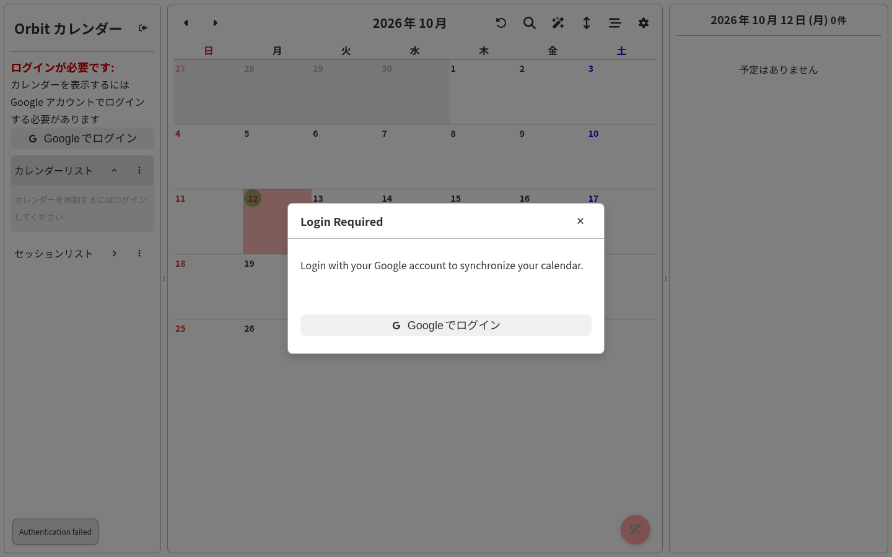

カレンダーの表示・編集には Google カレンダーへのアクセス許可が必要です。
写真共有・連絡先連携・クラウド同期などの追加機能は、個人設定からそれぞれ別途認可します(後述)。

### 2. カレンダーが表示される

ログインすると、現在の月のカレンダーと当日の予定一覧が表示されます。

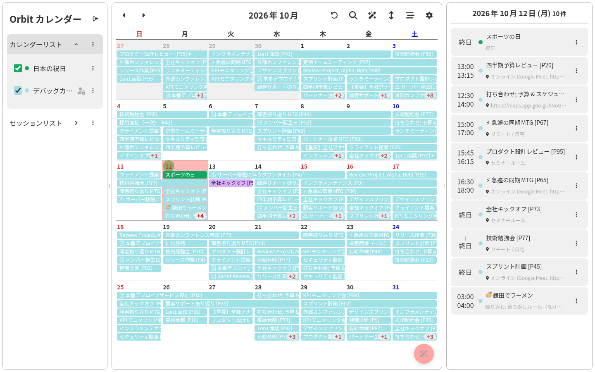

これで準備完了です。予定バーをクリックすれば詳細、日付セルの右クリックから「予定を作成」で新規登録ができます。

---

## 画面の構成

画面は 3 つのペインで構成されます(デスクトップ/タブレット表示時)。

| ペイン | 位置 | 役割 |
| --- | --- | --- |
| ナビペイン | 左 | 「Orbit カレンダー」のカレンダーリスト・セッションリスト。カレンダーの表示 ON/OFF やメニュー操作を行う |
| メインペイン | 中央 | 月/週のカレンダー本体。予定バーが並ぶ |
| サブペイン | 右 | 選択中の日付の予定一覧、またはイベント詳細・フォーム・設定画面など |

- デスクトップではペインの境界をドラッグして幅を調整できます(260〜600px)。
- モバイルではナビペインはハンバーガーメニューから、サブペインは画面下部のボトムシートとして表示されます。

---

## カレンダーの表示

中央ペインのカレンダーは 3 種類の表示モードを切り替えられます。

### 月表示(横)

標準のマンスリービューです。各セルに予定バーが表示され、表示しきれない予定は「+N」としてまとめられます。

### 縦スクロール月表示

ツールバーの ↕ アイコン(「縦スクロール表示にする」)を押すと、月が縦に連続して並ぶスクロールビューになります。

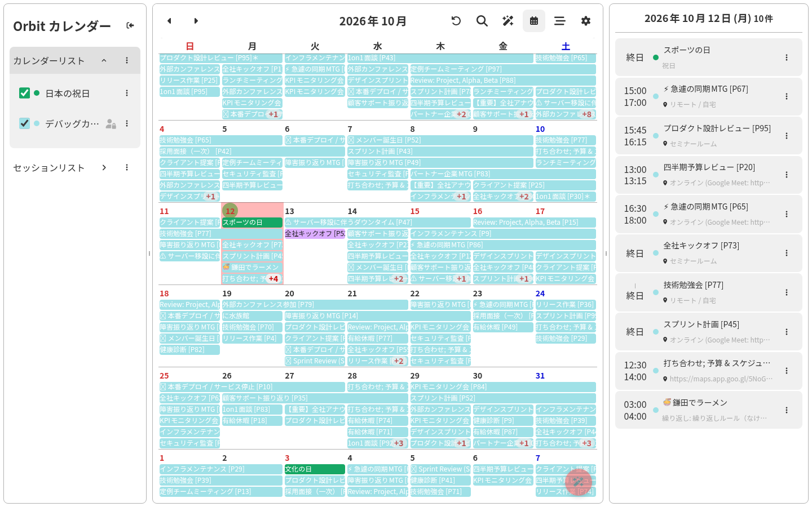

### 週表示(タイムライン)

ツールバーのアイコン(「タイムライン表示にする」)を押すと、1 週間の時間軸ビューになります。予定が時間帯に沿ってブロック表示されます。

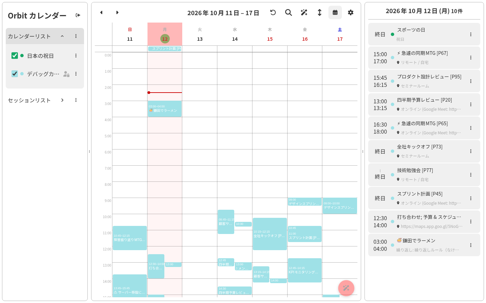

### 日付の移動と選択

- **◀ ▶** …前月/次月(週表示では前週/次週)へ移動
- **今日に戻る** ボタン …現在日へ戻る
- **日付セルをクリック** …その日を選択し、右ペインにその日の予定一覧を表示
- **日付セルをドラッグ** …期間を選択し、その範囲を対象にしたコンテキストメニューを表示(予定の作成フォームでも日付範囲の指定に使える)
- **日付セルを右クリック** …コンテキストメニューを表示
- **矢印キー(デスクトップ)** …選択日を上下左右に移動

### コンテキストメニュー

日付セルを右クリックすると次のメニューが出ます。

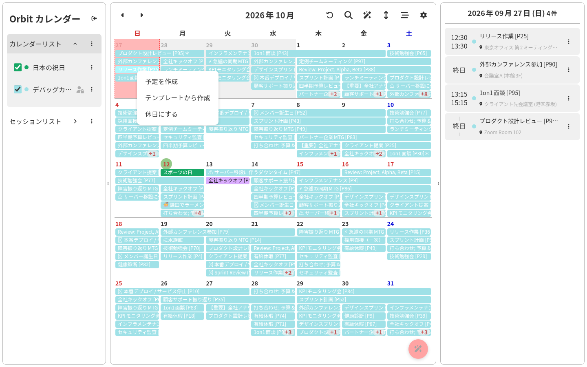

| メニュー | 動作 |
| --- | --- |
| 予定を作成 | その日を開始日にした予定作成フォームを開く |
| タスクを追加 | その日を対象日にしたタスク登録フォームを開く |
| テンプレートから作成 | 保存済みテンプレートを選んで予定を作成 |
| 休日にする | その日をカスタム休日として登録(日付が設定色で表示される) |

### その他の表示要素

- **祝日** …日本の祝日は設定色で日付が着色されます
- **カスタム休日** …コンテキストメニューから任意の日を休日化できます
- **週末の曜日** …個人設定で「休日にする曜日」を指定すると、その曜日の日付が着色されます
- **✨ FAB(右下)** …自然言語登録(Quick Add)を開くショートカット

---

## 予定の操作

### 詳細の表示

予定バーをクリック(モバイルでは予定一覧のカードをタップ)すると、右ペインに詳細が表示されます。

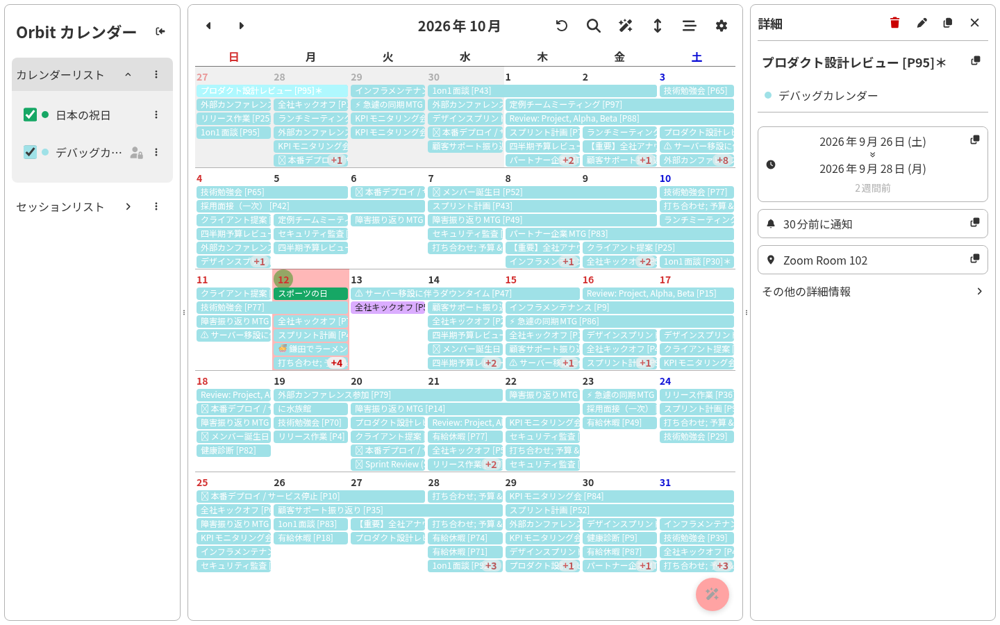

詳細画面では次の操作ができます。

- **タイトル/日時/通知/場所/説明の確認** …各行のコピーボタンでクリップボードにコピー可能
- **Edit** …編集フォームを開く
- **複製** …複製フォームを開く
- **Delete** …確認ダイアログのあと予定を削除(繰り返し予定はシリーズ全体が削除される)
- **参加回答** …招待された予定では「承諾」「辞退」を回答できる
- **写真アルバム** …紐づけられた Google Photos アルバムを表示
- **その他の詳細情報** …繰り返しルール・公開設定・タグなどを展開表示

### 作成

予定の作成方法は複数あります。

1. 日付セルを**右クリック →「予定を作成」**
2. 日付セルを**ドラッグして期間を選択 →「予定を作成」**(選択した期間が開始〜終了日に入る)
3. 週表示(タイムライン)で**時間帯をクリック**して作成
4. **テンプレートから作成**(コンテキストメニュー/テンプレート一覧)
5. **自然言語で登録**(Quick Add、後述)

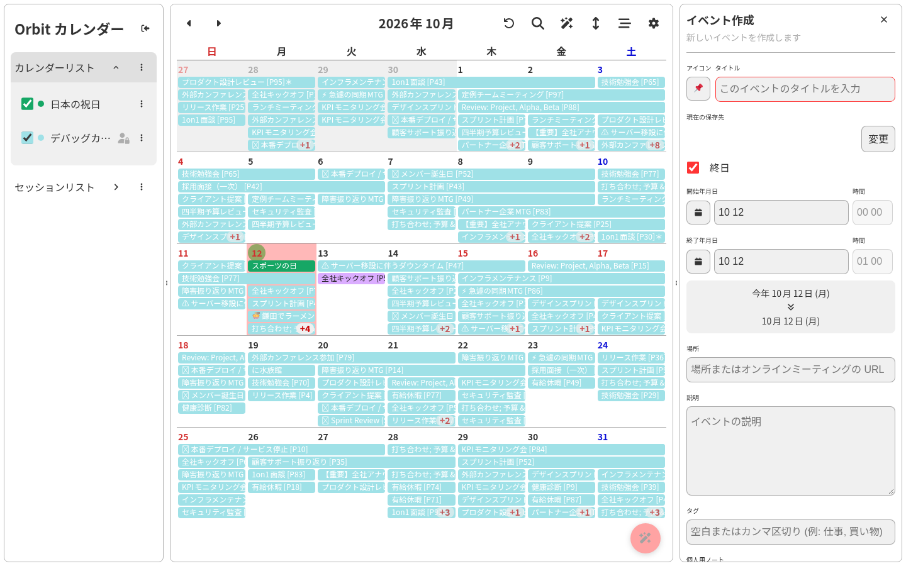

#### フォームの項目

| 項目 | 内容 |
| --- | --- |
| アイコン | 絵文字セレクターから予定のアイコンを設定 |
| タイトル | 予定名。最近使ったタイトルが候補として表示される |
| カレンダー | 登録先のカレンダーを選択 |
| 終日 | チェックで終日予定(時刻入力が無効化) |
| 開始/終了 | 日付・時刻を入力。カレンダーアイコンから日付ピック(カレンダー上の日付をクリックして選ぶモード)も可 |
| 場所 | 場所またはオンラインミーティングの URL(Google Maps リンクはリンクカード化) |
| 説明 | 予定の説明文 |
| タグ | 空白/カンマ区切りで複数指定。検索で `#タグ` としてヒットする |
| 個人メモ | 自分だけに表示されるメモ(他ユーザには非公開) |

#### 詳細設定(折りたたみ)

| 項目 | 内容 |
| --- | --- |
| 招待するユーザー | 連絡先(People API)やメールアドレスから参加者を追加 |
| タイムゾーン | 終日でない予定のタイムゾーンを指定 |
| 公開設定 | デフォルト/公開/非公開 |
| 繰り返し | RRULE ベースの繰り返しルール(毎日/毎週/毎月・曜日指定・間隔・終了条件など) |
| 通知設定 | 複数の通知タイミング(分前)を追加 |
| 写真アルバム | 予定に Google Photos のアルバムを作成・紐づけ(要写真共有の認可) |
| イベントの色 | カレンダー色とは別に予定個別の色を指定 |

> [!TIP]
> **Ctrl+Enter**(Mac は **Cmd+Enter**)でフォームを送信できます。送信キーの挙動は個人設定で変更可能です。

### 編集

詳細画面の **Edit** から編集フォームを開きます。作成フォームと同じ項目を変更して保存します。

### 複製

詳細画面の **複製** から複製フォームを開きます。日時を変えて同じ内容の予定をすばやく作れます。

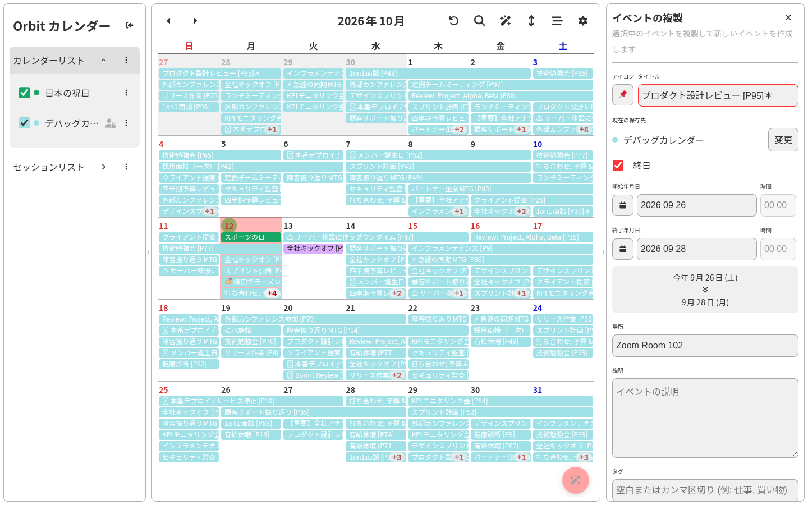

### 削除

詳細画面の **Delete**、または予定カードのコンテキストメニューから削除します。
確認ダイアログで「本当にこのイベントを削除しますか?」に同意すると削除され、失敗時(オフライン等)はオンライン復帰後の再同期に回ります。

### 自然言語で登録(Quick Add)

ツールバーの ✨ アイコンまたは右下の FAB から、自然言語入力で予定を作成できます。

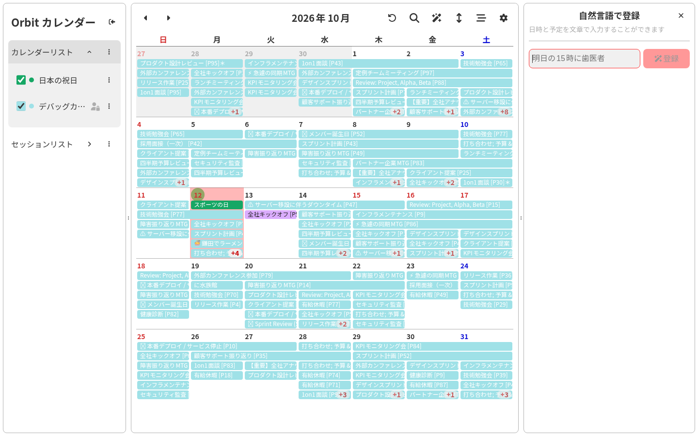

「明日の15時に歯医者」「来週の水曜 10時から2時間 MTG」などと入力して **登録** を押すと、日時はルールベースで、その他の意味部分は端末上の AI(WebLLM)で解析され、結果が作成フォームへ流し込まれます。
内容を確認・修正してから保存してください(直接登録ではありません)。

- AI 解析には WebGPU 対応ブラウザが必要です。非対応時は自動で簡易解析に切り替わります
- PWA としてインストール済みの場合、AI モデルがバックグラウンドで事前キャッシュされます

### テンプレート

よく使う予定の内容をテンプレートとして保存できます。

- **テンプレートとして保存** …作成/編集フォーム下部のボタンから現在の入力内容を保存
- **テンプレートから作成** …コンテキストメニューまたはテンプレート一覧から選択して作成

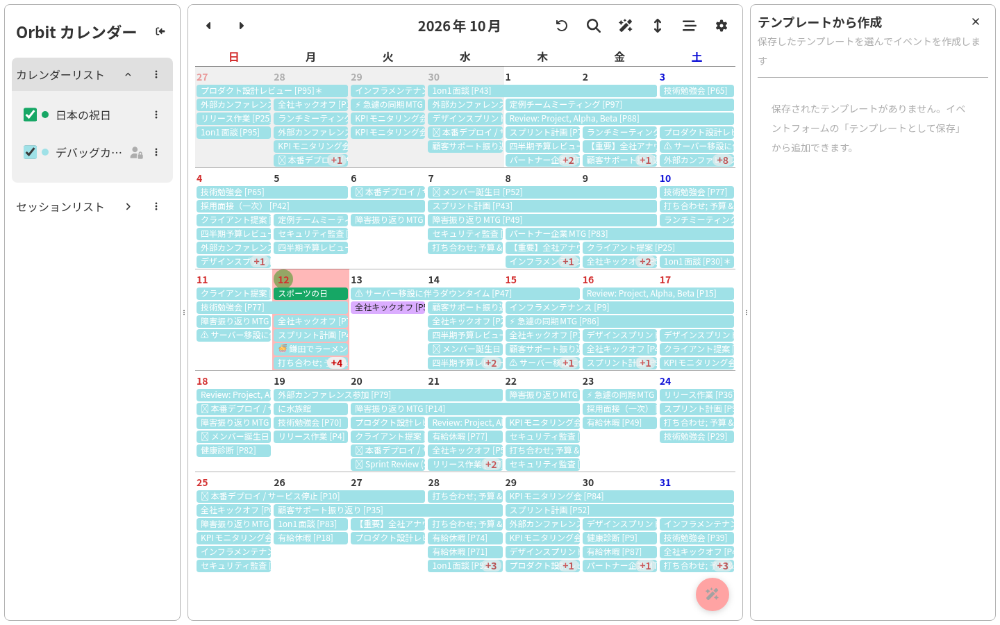

---

## 予定の検索

ツールバーの 🔍 アイコンから検索画面を開きます。
タイトル・説明・場所・タグ(`#tag` 形式)などで過去〜未来の予定を横断検索できます。

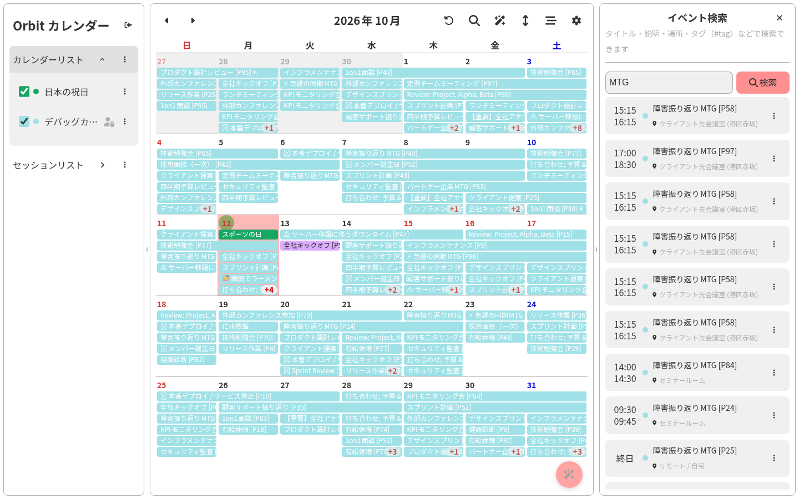

キーワードを入力して検索ボタンを押すと結果がカードで一覧表示されます。カードをクリックすると詳細が開きます。

---

## タスク

予定とは別に「タスク」を管理できます。タスクは日付に対する ToDo で、カレンダーセルの「タスク +N」表示や日付一覧でまとめて確認できます。内部的には Google カレンダーの非公開イベントとして保存されるため、オフラインでも利用でき、共有カレンダーの相手には表示されません(招待した参加者は除く)。

### タスクの作成

1. 日付セルを**右クリック →「タスクを追加」**(選択した日付が対象日に入る)
2. 週表示(タイムライン)で**時間帯を右クリック →「タスクを追加」**(時間指定タスク)

タスク登録フォームでは次の項目を設定できます。

| 項目 | 内容 |
| --- | --- |
| タイトル | タスク名 |
| カレンダー | 登録先のカレンダー |
| 終日 | チェックで終日タスク(時間指定タスクは開始時刻に通知) |
| 開始/終了 | 日付・時刻を入力。日付ピックも可 |
| タスクのステータス | 「未着手」「進行中」「保留」「完了」から選択(後から詳細画面で変更可能) |
| 未完了のとき翌日へ持ち越す | ONのタスクは期限が過ぎても未完了なら翌日へ自動で日付が移る |
| メモ | 任意の説明文 |
| 招待するユーザー | 招待した参加者はタスクのステータスを変更できます |

### タスクの表示と操作

- **カレンダーセル** …未完了タスクがある日付は「タスク +N」と表示されます
- **日付一覧** …タスクのカードに完了チェックボックスが付き、チェックで「完了」になります。完了済みタスクは一覧の末尾「完了済みタスク」アコーディオンにまとまります(チェックを外せば「未着手」に戻ります)
- **詳細画面** …ステータスは「未着手」「進行中」「保留」「完了」のほか、カスタムステータスも自由に入力できます。翌日持ち越しの ON/OFF もここで切り替えられます

### タスクの通知

- **時間指定タスク** …開始時刻に通知されます
- **終日タスク** …個人設定の「終日タスクの通知時刻」で指定した時刻に、その日のタスクがまとめて通知されます(複数時刻を指定可能・すべて削除すると通知しません)

---

## カレンダーの管理

### カレンダーリスト(ナビペイン)

左ペインの「カレンダーリスト」には同期中のカレンダーが表示されます。

- **チェックボックス** …カレンダーの表示 ON/OFF
- **⋮ メニュー** …カレンダー詳細・共有設定などの操作

### セッションリスト

「セッションリスト」には、カレンダー ID 検索や連絡先検索から一時的に追加した「セッションカレンダー」が表示されます。アカウントのカレンダー一覧に追加せずに他者のカレンダーを覗き見る用途に使えます。

### カレンダーの作成

「新しいカレンダーを作成」から、名前・説明・タイムゾーン・テーマカラーを指定してカレンダーを作成します。

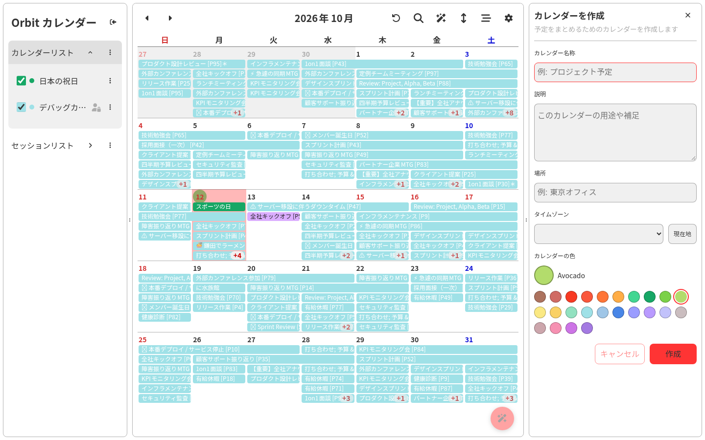

### カレンダーの追加(ID 指定)

共有してもらったカレンダー ID を入力して、自分の一覧に追加できます。

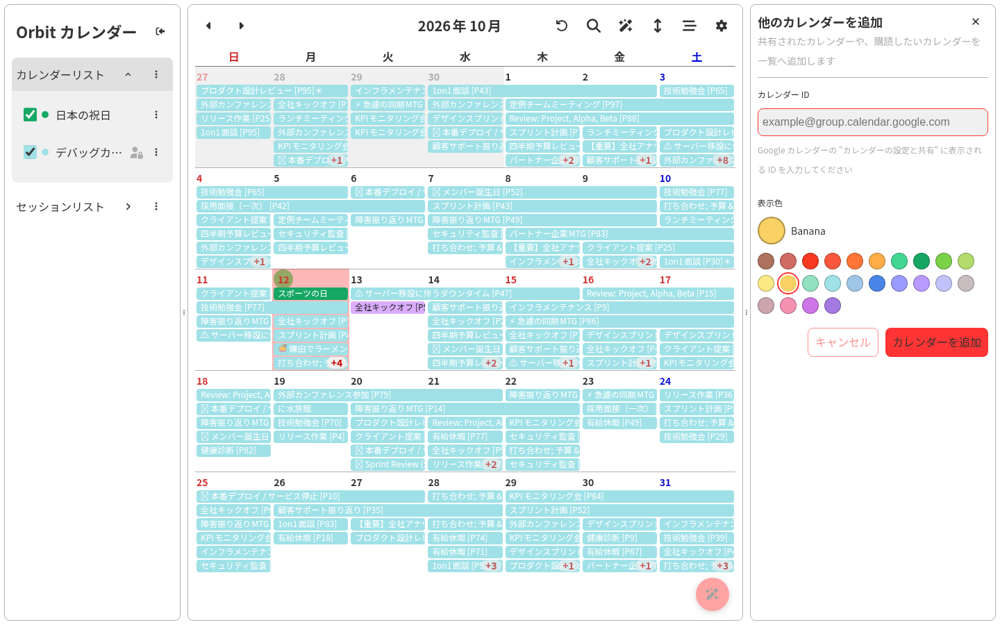

### カレンダー詳細

カレンダーリストのメニューから詳細画面を開くと、カレンダーの色変更・プロパティ編集・削除などができます。

---

## カレンダーの共有

Orbit では 2 種類の共有があります。

### 期間を指定して共有

指定した期間・カレンダーの予定だけをコピーした「コピーカレンダー」を作成し、相手の Google アカウントに共有します。
権限を「予定の有無のみ(空き時間)」にすれば、予定の詳細を見せずに空き時間だけを伝えられます。作成後は定期的に自動同期され、有効期限を過ぎると共有カレンダーは削除されます。

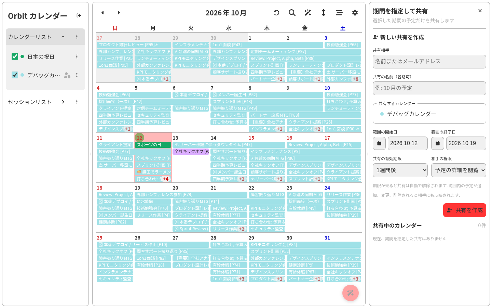

設定項目:

| 項目 | 内容 |
| --- | --- |
| 共有相手 | 名前またはメールアドレス(連絡先検索・直接入力) |
| タイトル | 共有用に生成されるコピーカレンダーの名前(例: 10月の予定) |
| 対象カレンダー | 共有する自分のカレンダー(複数選択可) |
| 期間 | 共有する開始日〜終了日 |
| 有効期限 | 共有の有効期間(1週間後/2週間後/1か月後/日付指定) |
| 権限 | 「予定の詳細を閲覧」または「予定の有無のみ(空き時間)」 |

### 共有設定(アクセス権の管理)

カレンダーごとの共有 ACL(誰にどの権限で共有するか)を管理します。

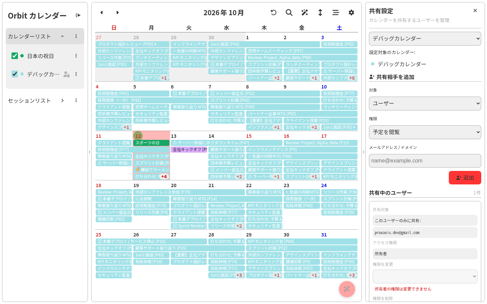

- 共有相手の Google アカウントを追加し、権限(閲覧/編集など)を選択
- 既存の共有ルールの一覧・削除

---

## 個人設定

ツールバーの ⚙ アイコンから個人設定を開きます。セクションをクリックすると折りたたみで展開します。

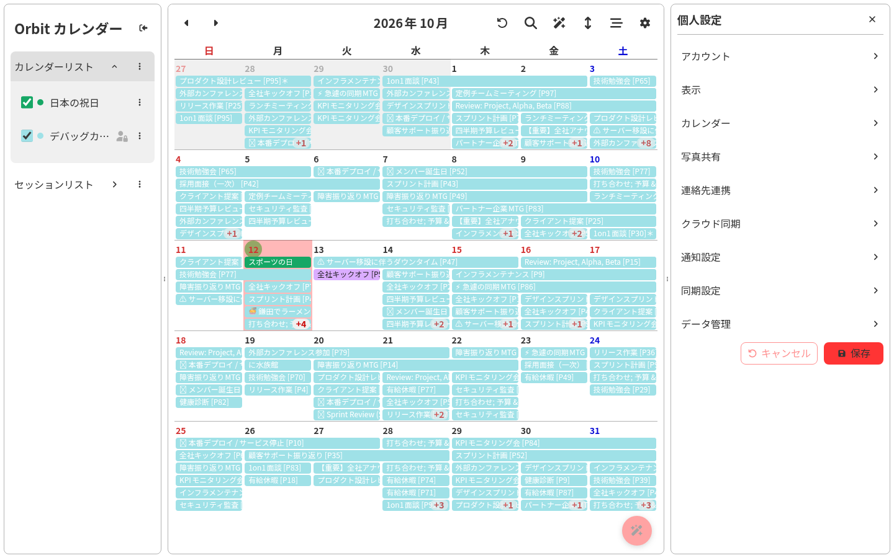

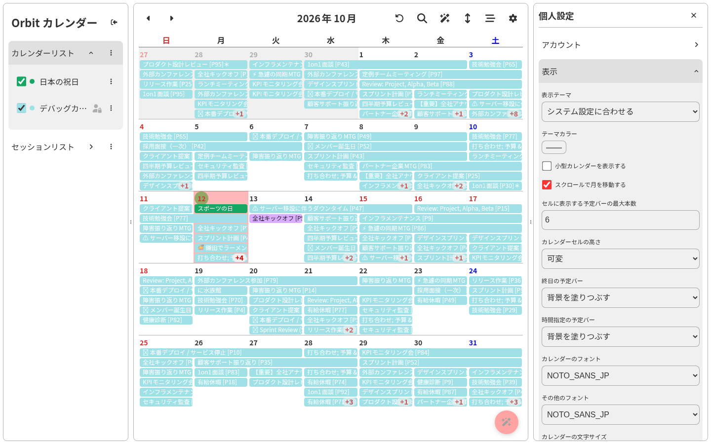

| セクション | 主な設定項目 |
| --- | --- |
| アカウント | ログイン中のアカウント表示・ログアウト |
| 表示 | 表示テーマ(ライト/ダーク/システム)、テーマカラー、小型カレンダー、スクロール月移動、セルの予定バー最大本数、セル高さ、予定バーの塗り方、カレンダー/その他のフォント・文字サイズ |
| カレンダー | 週の開始曜日、休日にする曜日とその色、祝日/カスタム休日の色、曜日ラベルの変更 |
| 写真共有 | Google Photos 連携の有効化(別途 OAuth 認可) |
| 連絡先連携 | People API による連絡先検索の有効化(別途 OAuth 認可) |
| クラウド同期 | Google Drive(appDataFolder)への設定・セッションカレンダーの同期(別途 OAuth 認可) |
| 通知設定 | 予定通知の ON/OFF・通知タイミング・モバイルへの Web Push |
| 同期設定 | オフライン利用・バックグラウンド同期など |
| データ管理 | ローカルキャッシュのクリアなど |

設定を変更したら下部の **保存** ボタンで保存します。**キャンセル** または右上の × で変更せずに戻ります。

---

## モバイルでの使い方

モバイルでは画面が 1 カラムになり、3 ペインが次のように再配置されます。

- **メイン(カレンダー)** …常時表示
- **下部シート(サブペイン)** …選択日の予定一覧や詳細・フォーム。上のハンドルをドラッグ/フリックで高さ調整・収納、収納中のタップで半分まで再表示
- **ナビ(カレンダーリスト)** …左上の ☰ で開くドロワー。左端スワイプや × で閉じる

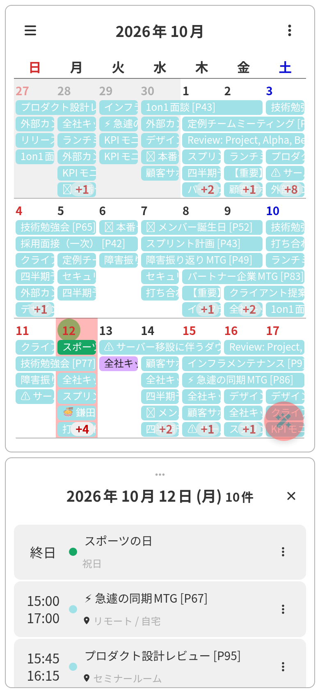

予定カードをタップすると詳細が開きます。

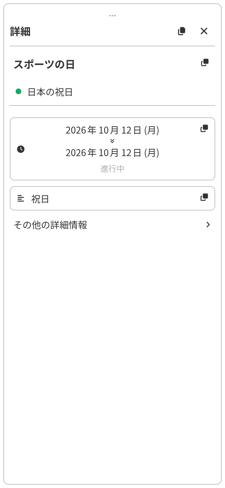

ホーム画面に追加(PWA インストール)すると、フルスクリーンで動作し、プッシュ通知やオフライン起動も利用できます。

---

## オフライン・PWA・通知

- **PWA インストール** …ブラウザの「ホーム画面に追加/インストール」からアプリとしてインストールできます
- **オフライン閲覧** …取得済みのカレンダー・予定は端末のキャッシュに保存され、オフラインでも閲覧できます
- **オフライン編集** …オフライン中の作成・更新・削除はキューに積まれ、オンライン復帰時に自動で再送されます
- **通知** …予定の通知はアプリ起動中はアプリ内で、アプリを閉じていても Service Worker/Web Push 経由で配信されます(対応ブラウザのみ)
- **クラウド同期** …Drive 同期を有効にすると、個人設定やセッションカレンダーがデバイス間で同期されます
